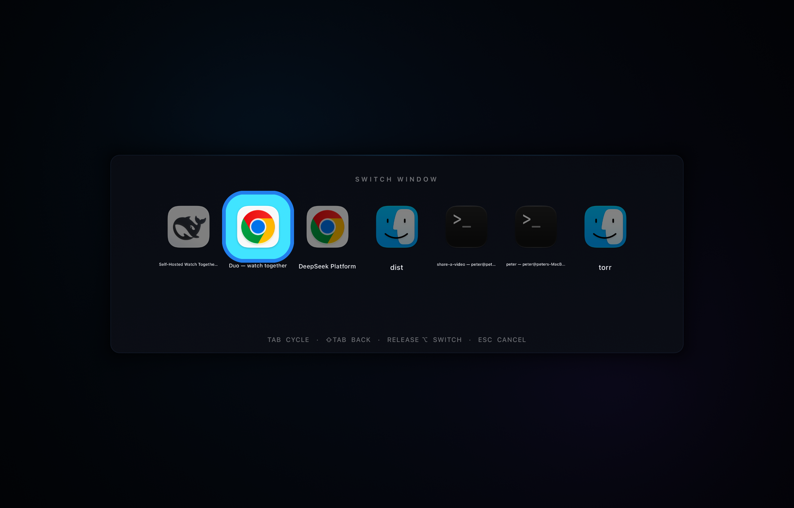

# New Window Plz

A tiny macOS menu-bar app with two jobs:

1. **Plain Dock clicks open a new window.** Hold **⇧ Shift** — or any other modifier — for the Dock's normal behavior.
2. **⌥Tab is a fast, current-Space window switcher.** It lists one entry per on-screen window, not just apps. Hold Option, tap Tab to cycle, release Option to raise the selected window.

Both use one resident Metal surface. There is no window creation, SwiftUI evaluation, or GPU wait on the reveal path. Window snapshots are optional and are captured asynchronously after the switcher is already visible.



## Behavior

### Dock clicks

| Gesture | Result |
| --- | --- |
| Click a running app's Dock icon | The app receives its own **New Window** command via Accessibility |
| Click an app that is not running | Native launch (already a new window) |
| Shift-click | Native Dock behavior, untouched |
| ⌘ / ⌥ / ⌃-click | Native Dock behavior, untouched |
| Right-click, folders, Trash, minimized-window tiles | Untouched |
| Drag while clicking | Cancelled; the click is consumed rather than acting on another app |

System launchers stored in the Dock (**Apps**, **Launchpad**, Mission Control) are deliberately excluded.

### ⌥Tab window switcher

| Input | Result |
| --- | --- |
| Hold **⌥**, press **Tab** | Open the switcher, initially selecting the next window |
| Press **Tab** again | Move forward through the current-Space windows |
| **⇧⌥Tab** | Move backward |
| **← / ↑** | Move backward |
| **→ / ↓** | Move forward |
| Release **⌥** | Raise the selected window |
| **Return** | Raise immediately |
| **Esc** | Dismiss without switching |

Only windows that are currently composited in the active Space are listed. Minimized windows, windows on other Spaces, and the app's own windows are excluded. Multiple windows from the same app appear as separate entries with their window titles.

The selected window is raised by matching its `CGWindowID` to the app's Accessibility window list and performing `AXRaise`. If that mapping fails, the app is still activated.

The system **⌘Tab** switcher is intentionally left alone. New Window Plz uses **⌥Tab** so both can coexist.

### Optional window snapshots

Enable **Window switcher → Show window snapshots** in Settings (or from the status menu). Snapshot mode shows up to five large window cards per page with:

- a live thumbnail of each visible window
- the app icon and window title
- a pixel-accurate rounded selection outline
- a horizontal slide when crossing a page boundary, so the next window visibly enters from the right instead of the row jumping

Snapshots require **Screen Recording** permission because macOS protects window contents. Captures are requested only for visible cards, run on a background queue, and populate the cards after the switcher has already opened. The reveal path never waits for a capture.

If snapshots remain blank after granting Screen Recording, relaunch the app. The toggle can stay enabled and the switcher falls back to icons until permission is active.

## Install

**[Download New Window Plz 1.2](https://github.com/PeterHindes/NewWindowPlz/releases/latest/download/NewWindowPlz-macOS.zip)** — 1.2 MB, macOS 14+, universal. There's also a [landing page](https://peterhindes.github.io/NewWindowPlz/).

The download is ad-hoc signed but not notarized, so macOS warns the first time you open it. Right-click → **Open**, or clear the quarantine flag once:

```bash
xattr -dr com.apple.quarantine "/Applications/New Window Plz.app"
```

To build it yourself instead, you need macOS 14 or later, Xcode 27+, and [XcodeGen](https://github.com/yonaskolb/XcodeGen).

```bash
./scripts/build.sh
open "dist/New Window Plz.app"
```

For normal use, move `dist/New Window Plz.app` to `/Applications` **before** granting permissions.

1. Launch the app. It appears as a menu-bar icon (no Dock icon).
2. Click **Grant Accessibility Access** and enable **New Window Plz** in **System Settings → Privacy & Security → Accessibility**.
3. Click a running Dock icon, then try holding **⌥** and pressing **Tab**.
4. For snapshots, enable the option in Settings and grant **Screen Recording** when prompted.

Accessibility is used to read the Dock, trigger the target app's own New Window menu command, intercept ⌥Tab, and raise a specific window. Screen Recording is used **only** when snapshots are enabled, and only to capture the visible windows in the switcher. There is no network access and no access to window contents otherwise.

If System Settings shows a stale checked **New Window Plz** entry but the welcome screen still says permission is needed, remove the stale entry with **–**, add the current app with **+**, toggle it on, and relaunch. The app is ad-hoc signed locally, so a rebuild produces a new code identity.

## Why the overlays are fast

Most overlay utilities construct a view or window when invoked, then wait for layout, WindowServer ordering, and a first frame. This app is built around the opposite constraint:

- **One persistent surface.** The full-screen borderless `NSPanel` is created once, ordered in once, and left resident at `alpha 0`. Showing either overlay is an alpha flip, not a window creation or `orderFront`.
- **No SwiftUI on the hot path.** SwiftUI is used only for Settings and onboarding. The overlays are a layer-hosting `NSView` with a `CAMetalLayer`.
- **Prewarmed Metal.** Shader compilation and pipeline creation happen at launch. Demo text atlases are built at launch. App icons and window labels are prepared when the window catalog changes, not when ⌥Tab is pressed.
- **A cached current-Space catalog.** Window enumeration is expensive enough to miss a frame, so it runs on a background queue and refreshes on app/space changes plus a low-frequency fallback timer. Opening the switcher reads the cache; a background refresh updates the scene if something changed.
- **Tab is cheap.** A selection change updates an index in the resident scene and submits a new command buffer. There is no image rasterization, window query, or texture upload.
- **Snapshots never block.** Captures run off-main after the overlay is up and fill in cached textures as they arrive.
- **No GPU waits.** The renderer submits one command buffer and never calls `waitUntilCompleted` on the interactive path. There are no readbacks.
- **No app activation.** The panel is a non-activating `NSPanel` at `.popUpMenu` level, joins all Spaces, and works over full-screen apps.
- **Idle means idle.** The display link is paused whenever the overlay is hidden.

Measured on this M1 Max:

```text
OVERLAY_BENCHMARK  reveal_median_us=139.0      (demo overlay)
SWITCHER_BENCHMARK reveal_median_us=206.9      (7-window switcher)
                   warm_end_to_end_median_us=433.7
                   cold_scan_us=26439.0
```

That is **~0.21 ms to reveal a cached window list** and **~0.43 ms end-to-end** with window enumeration served from cache. The one-time cold scan (first use, or whenever the window cache is empty) is ~26 ms and happens before the cached path is ready. The actual pixels appear on the next display refresh (8.3 ms at 120 Hz), the physical lower bound for a compositor overlay.

The 1.2 release was exercised end-to-end on this Mac: current-Space window enumeration, exact window raising, live window snapshots, and the page-slide animation all work.

Run the benchmarks yourself:

```bash
./scripts/benchmark.sh
./scripts/switcher-benchmark.sh
```

The Settings window reports **Open** and **Switch prep** timings after you click **Preview**.

### Why this differs from DockDoor's preview path

DockDoor was a useful reference for two Dock API details: the Dock's `AXSelectedChildren` gives the hovered item (including magnification), and modern application tiles expose `AXURL`, which resolves an exact bundle instead of matching by title. This app uses that approach for Dock clicks and then diverges deliberately for overlays: there is no SwiftUI/window construction at reveal time. One resident Metal surface hosts the current-Space window switcher and the renderer test.

DockDoor is GPLv3. No DockDoor source code was copied; it was used as a behavioural/API reference.

## How the window switcher works

1. A dedicated `CGEventTap` thread watches key down/up and modifier changes. It is installed only while Accessibility is granted and the switcher is enabled.
2. **⌥Tab** is consumed before the focused app sees it. The controller takes the cached current-Space window list and reveals the prewarmed overlay.
3. The list comes from `CGWindowListCopyWindowInfo` with `.optionOnScreenOnly`, filtered to normal application windows and the active Space. The background catalog refreshes on app activation, app launch/termination, Space changes, and a 1.5-second fallback timer.
4. Repeated Tab and arrow presses update only the selected index; the renderer redraws the cached app-icon and window-title textures.
5. Releasing Option commits. The overlay is hidden at `alpha 0`, the app is unhidden if needed, and the exact window is raised via Accessibility. The Option key-up is passed through so the underlying app's modifier state stays balanced.
6. Escape cancels; Return commits immediately. While the switcher is modal, unrelated keystrokes are swallowed rather than leaking into the app underneath.

Snapshot mode uses the same flow. The visible window IDs are handed to a background capture service; completed images become Metal textures and the card is redrawn. The card placeholders are shown until captures arrive.

## How Dock interception works

1. A mouse `CGEventTap` on a dedicated user-interactive thread watches left mouse down/up. It only consults Accessibility for clicks near a display edge or a cached Dock tile.
2. On mouse down, it reads the Dock list's `AXSelectedChildren`, confirms the pointer is inside its current frame, and resolves `AXURL → bundle identifier → running app`.
3. If the tile is a running app and no shortcut modifier is held, the mouse down and up are consumed.
4. On mouse up, it looks for a **New Window** menu item in the target app, preferring titles containing both “new” and “window”, then **New**, then a Command-N equivalent. It presses that item.
5. If no usable menu item exists, it activates the app and posts Command-N directly to its process.
6. The target app is brought forward. If it does not support multiple windows, it simply activates.

## Project layout

```
Sources/
  AltTab/      current-Space window catalog, Option-Tab tap, snapshots, activation
  App/         App lifecycle, status item, menu
  Core/        Settings, permissions, login item, logging
  Dock/        Mouse event tap, Dock AX inspection, new-window action
  Overlay/     Persistent NSPanel, CAMetalLayer view, Metal renderers
  UI/          SwiftUI onboarding and settings
Resources/     Info.plist, shader source, app icon
Tests/         Unit tests for policy, geometry, selection, scoring, Metal
scripts/       build / run / test / benchmark / self-test
```

## Development

```bash
# Open in Xcode
xcodegen generate
open NewWindowPlz.xcodeproj

# Build and verify core paths without a GUI test runner
./scripts/selftest.sh
./scripts/benchmark.sh
./scripts/switcher-benchmark.sh

# Render static previews
"dist/New Window Plz.app/Contents/MacOS/NewWindowPlz" --overlay-preview .build/overlay.png
"dist/New Window Plz.app/Contents/MacOS/NewWindowPlz" --alt-tab-preview .build/switcher.png
"dist/New Window Plz.app/Contents/MacOS/NewWindowPlz" --alt-tab-preview .build/switcher-snapshots.png --snapshots

# Unit tests (compiled into the app-hosted test bundle)
./scripts/test.sh
```

The test target compiles all XCTest cases. On restricted/headless environments where Xcode cannot allocate a pseudo-terminal for the test host, use the built-in `--self-test` command instead.

## Limitations

- macOS only. Not sandboxed and not Mac App Store compatible: Accessibility event taps require the non-sandboxed behavior.
- The switcher intentionally shows only the active Space's on-screen windows. Minimized windows and windows on other Spaces are not listed.
- Snapshot mode requires Screen Recording permission. macOS may require an app relaunch after the grant.
- Secure input fields can prevent global keyboard taps from seeing ⌥Tab.
- Apps that have neither a New Window menu item nor a Command-N behavior cannot be made multi-window; they activate normally.
- Rebuilding with a different ad-hoc signature may require re-granting Accessibility and Screen Recording.
- Multiple running instances of the same bundle currently resolve to the first matching instance.
